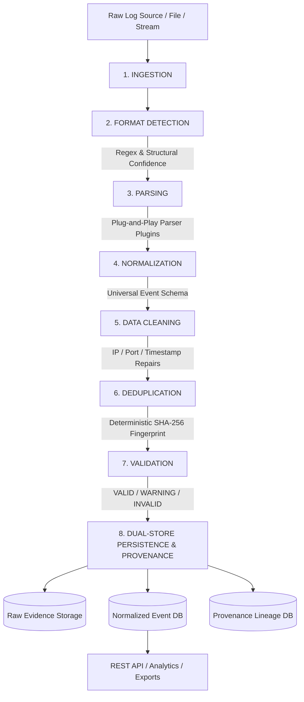

# ULPF — Universal Log Pre-processing Framework (Backend)

**SIH Problem Statement:** 26156 — Universal Log Pre-processing Framework  
**Organization:** National Technical Research Organisation (NTRO)  
**Category:** Software | **Theme:** Blockchain & Cybersecurity  
**Team:** Akatsuki  

---

## 📌 Executive Summary

**ULPF (Universal Log Pre-processing Framework)** is an enterprise-grade, air-gapped log ingestion, normalization, cleaning, deduplication, and provenance auditing framework designed specifically for high-security environments like NTRO. 

Heterogeneous security logs originating from firewalls, operating systems, applications, and network appliances (Syslog, JSON, CSV, CEF, LEEF, XML) are auto-detected, parsed via plug-and-play modules, normalized into a **Universal Event Schema**, cleaned, deduplicated using deterministic SHA-256 fingerprinting, validated, and persisted with **100% Lossless Raw Event Preservation** and **Full Provenance Lineage Tracking**.

---

## 🏗️ Architecture & Processing Pipeline



---

## 🛠️ Technology Stack

- **Language:** Python 3.12+
- **API Framework:** FastAPI
- **Data Validation & Schemas:** Pydantic v2
- **ASGI Server:** Uvicorn
- **Database & Storage:** SQLite + SQLAlchemy ORM (Air-gapped local persistence)
- **Containerization:** Docker & Docker Compose
- **Zero Cloud Dependencies:** Capable of running completely offline in air-gapped security enclaves.

---

## 🚀 Quick Start & Local Running

### Prerequisites
- Python 3.12+
- Docker & Docker Compose (optional for containerized deployment)

### 1. Running Locally (Air-gapped)

```bash
# Navigate to backend directory
cd backend

# Create virtual environment
python -m venv venv

# Activate virtual environment
# Windows:
venv\Scripts\activate
# Linux/macOS:
source venv/bin/activate

# Install dependencies
pip install -r requirements.txt

# Run Uvicorn development server
uvicorn app.main:app --host 0.0.0.0 --port 8000 --reload
```

The API server will start at: `http://localhost:8000`  
Interactive Swagger API documentation: `http://localhost:8000/docs`

---

## 🐳 Containerized Running via Docker

To spin up the ULPF backend in a containerized environment:

```bash
# From root directory:
docker compose up --build
```

Access services at:
- **Backend API:** `http://localhost:8000`
- **Swagger Interactive API Docs:** `http://localhost:8000/docs`

---

## 📡 API Endpoints Reference

| HTTP Method | Endpoint | Description |
|---|---|---|
| `GET` | `/health` | System health status, version, and air-gapped status |
| `GET` | `/api/parsers` | List registered parser plugins and supported formats |
| `POST` | `/api/ingest` | Ingest raw log payload or uploaded file |
| `POST` | `/api/process` | Execute full 8-stage pipeline on raw log content |
| `POST` | `/api/process/demo` | Execute deterministic demo pipeline on realistic mixed log dataset |
| `GET` | `/api/events` | Search and filter normalized security events |
| `GET` | `/api/events/{event_id}` | Retrieve specific normalized event detail |
| `GET` | `/api/events/{event_id}/raw` | **Lossless raw event evidence**, SHA-256 hash & byte length |
| `GET` | `/api/events/{event_id}/provenance` | Complete provenance audit trail and stage history |
| `GET` | `/api/analytics/summary` | Dashboard KPI metrics summary |
| `GET` | `/api/analytics/severity` | Event severity distribution breakdown |
| `GET | `/api/analytics/sources` | Log source / vendor distribution breakdown |
| `GET` | `/api/analytics/event-types` | Event signatures breakdown |
| `GET` | `/api/pipeline/status` | Real-time status of pipeline processing stages |
| `GET` | `/api/stats` | Aggregate system metrics and hourly time series |
| `GET` | `/api/export/json` | Export normalized events (or forensic package) as JSON |
| `GET` | `/api/export/csv` | Export normalized events as standard CSV |
| `GET` | `/api/export/cef` | Export normalized events formatted as CEF logs |

---

## 🔍 SIH PS 26156 Requirement Mapping

| SIH Requirement | ULPF Implementation | Code Reference |
|---|---|---|
| **a) Complete Raw Event Preservation** | Original raw string stored byte-for-byte; SHA-256 hash computed (`sha256:...`); raw event is never mutated. | [`app/models/event.py`](app/models/event.py), [`app/services/cleaning_service.py`](app/services/cleaning_service.py) |
| **b) Source-Specific Attribute Extraction** | All non-standard / vendor-specific fields preserved losslessly in `source_fields` dict object. | [`app/normalization/normalizer.py`](app/normalization/normalizer.py) |
| **c) Common Event Taxonomy** | Standardized `UniversalEvent` schema (`event_id`, `timestamp`, `src_ip`, `dst_ip`, `username`, `severity`, `status`, `event_type`, etc.). | [`app/models/event.py`](app/models/event.py) |
| **d) Original ↔ Normalized Traceability** | Bidirectional linkage between normalized event, raw evidence store, SHA-256 hash, and `provenance_id`. | [`app/provenance/provenance_tracker.py`](app/provenance/provenance_tracker.py) |
| **e) Plug-and-Play Source Onboarding** | Extensible `BaseParser` and `ParserRegistry` allowing XML, Cisco, Snort, and proprietary plugins without touching core pipeline. | [`app/parsers/registry.py`](app/parsers/registry.py), [`app/parsers/base.py`](app/parsers/base.py) |
| **f) Unified Visibility** | Unified `GET /api/events` search endpoint supporting multi-field filtering over all ingested log formats. | [`app/api/events.py`](app/api/events.py), [`app/storage/event_repository.py`](app/storage/event_repository.py) |
| **g) SIEM / Data Lake Readiness** | Structured JSON, CSV, and CEF export endpoints suitable for enterprise SIEM/Data Lake ingestion. | [`app/api/export.py`](app/api/export.py) |
| **h) AI/ML-Ready Analytics** | Aggregated, cleaned, and structured metrics exposed without synthetic AI claims, optimized for ML pipeline training. | [`app/analytics/aggregator.py`](app/analytics/aggregator.py) |
| **i) Reduced Parser Development Effort** | Modular regex-based and structural format auto-detection selects parser automatically. | [`app/services/detection_service.py`](app/services/detection_service.py) |
| **j) Air-Gapped Deployment** | Zero external cloud API requirements; completely local execution using SQLite and FastAPI. | [`app/main.py`](app/main.py) |
| **k) Container / Platform Independence** | Fully containerized dockerized deployment via `Dockerfile` and `docker-compose.yml`. | [`Dockerfile`](Dockerfile), [`docker-compose.yml`](../docker-compose.yml) |

---

## 🧪 Running Unit & Integration Tests

```bash
# From backend directory:
python -m pytest tests -v
```

Tests cover:
- Parser format detection and extraction (`Syslog`, `JSON`, `CEF`, `LEEF`, `CSV`, `XML`)
- Data cleaning & repair without raw string mutation
- Deterministic deduplication using SHA-256 hashes
- Provenance tracking and stage history
- Pipeline orchestrator integration
- End-to-end FastAPI endpoint tests
